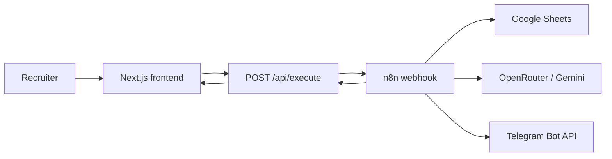
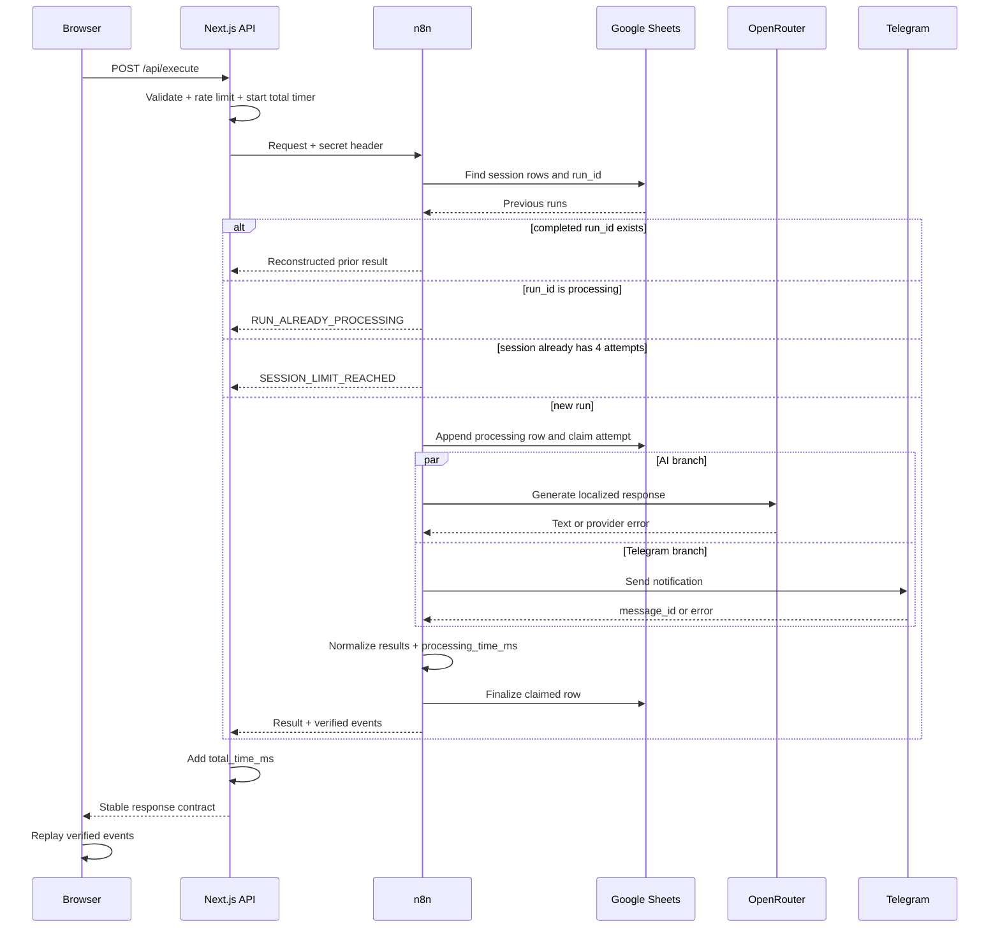

# Architecture

## System context



The browser communicates only with the Next.js application. It never receives provider credentials and never calls Google Sheets, OpenRouter, Telegram, or n8n directly.

## Request sequence



## Trust boundaries

### Browser

Untrusted values:

- `name`
- `company`
- `locale`
- `topic`
- `session_id`
- `run_id`

The browser may generate IDs, but the server validates their shape and never treats them as authentication.

### Next.js API gateway

Responsibilities:

- validate request schema;
- enforce body-size and platform/IP limits;
- add the n8n server secret;
- enforce a 12-second request timeout;
- normalize n8n failures;
- measure `total_time_ms`;
- prevent raw provider details from reaching the browser.

The API gateway does not call Google Sheets, OpenRouter, or Telegram directly.

### N8N

Responsibilities:

- verify the shared secret;
- determine or mark the attempt unavailable;
- enforce the four-run session limit when Sheets is available;
- claim and finalize `run_id` rows;
- run LLM and Telegram branches in parallel;
- create real stage timestamps;
- write audit data;
- return a stable response.

### External services

Google Sheets, OpenRouter, and Telegram are independent failure domains. Each result is normalized separately.

## State model

### Browser state

`sessionStorage`:

- `workflow_session_id`
- local count/status used only for immediate UX
- current pending `run_id` until its outcome is known

`localStorage`:

- selected locale

The backend remains authoritative whenever Google Sheets is available.

### Google Sheets row lifecycle

```text
missing
  -> processing       run_id and attempt claimed
  -> success          all required integrations completed
  -> partial_success  one or more integrations used fallback or failed
  -> failed           no useful result could be completed
```

A `processing` row older than two minutes is stale. A retry with that `run_id` returns `RUN_STATE_UNKNOWN`; it must not automatically repeat Telegram or LLM side effects.

## Timing boundaries

### processing_time_ms

Starts immediately before dispatching the LLM and Telegram branches. Stops after both branches have settled as success, fallback, or error.

It excludes:

- frontend rendering;
- browser network time;
- session lookup;
- initial processing-row append;
- final Sheets update;
- replay animation.

It is saved to Google Sheets.

### total_time_ms

Starts in the Next.js Route Handler after the request passes basic parsing and ends when the normalized response is ready to return.

It includes:

- validation after parsing;
- call to n8n;
- Sheets lookup and row lifecycle;
- LLM and Telegram work;
- response normalization.

It excludes browser rendering and replay. It is returned to the browser and is not written back to Sheets.

## Replay architecture

The MVP does not stream intermediate states. N8n returns `events[]` only after the execution has completed or reached a controlled partial result.

The browser uses an explicit presentation state model:

```text
ready -> submitting -> replay -> result
```

The ready state contains the retained personalization controls and one dominant CTA. During `submitting`, the UI may show neutral motion but cannot identify a current server node. Only after the response arrives may `replay` animate the server-confirmed events. The result state then gives visual priority to the Digital Twin avatar and response while retaining compact integration proof.

The frontend may compress the visual playback to approximately 2–4 seconds, but:

- it must preserve stage order based on timestamps;
- it must preserve visible parallelism when AI and Telegram timestamps overlap;
- it must display actual durations in technical logs;
- it must not turn an error into success;
- it must not label the replay as live.

## Failure isolation

- AI failure: deterministic localized fallback; Telegram continues.
- Telegram failure: AI continues; proof card shows failure.
- Sheets read failure: attempt becomes unavailable; generic AI scenario and Telegram continue.
- Sheets finalization failure: UI reports a Sheets error; the initial processing record may remain stale.
- Full n8n failure: gateway returns 502.
- Timeout: gateway returns 504 and keeps the same `run_id` available for a safe retry.

## Deployment boundary

- Frontend and API gateway: Vercel.
- Workflow: existing or separately provisioned n8n instance.
- Secrets: Vercel environment variables and n8n credentials.
- Source repository: contains no secrets and only a sanitized n8n export.

