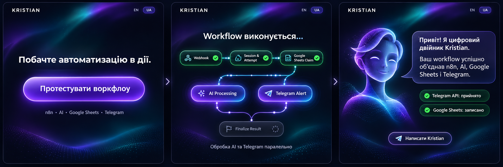

# Design direction v1

**Status:** approved as the approximate MVP UX direction  
**Approved:** 2026-11-10  
**Scope:** Phase 1 mock-first UI  
**Fidelity:** interaction and visual direction, not a pixel-final specification

## Reference storyboard



The image is a storyboard. Its three frames represent consecutive states of one page; the production UI must not show them as three columns at the same time. The generated avatar, exact spacing, colors, node labels, and illustrative copy are references rather than production assets.

## Intended impression

The experience should feel like a polished interactive landing page with one clear action, not a dashboard full of controls and not a decorative fake terminal.

The recruiter should understand the product through a short visual story:

1. Start the workflow.
2. Watch a server-verified replay of the automation.
3. Receive a personalized response from Kristian's Digital Twin with compact proof of the integrations.

## Experience states

### 1. Ready

- Use a minimal landing composition with a strong hero and one visually dominant workflow CTA.
- Keep the approved `name`, optional `company`, and `topic` inputs because the request contract and personalization still require them.
- Treat the inputs as compact supporting controls. They must not turn the first view into an admin dashboard.
- Keep the locale switch and privacy note accessible but visually secondary.
- The storyboard uses `Протестувати воркфлоу` as working concept copy. Production strings remain governed by `COPY.md` until a separate copy change is approved.

### 2. Executing and verified replay

- After a valid submit, the CTA and pre-run controls leave the main composition so the workflow becomes the visual focus.
- While the HTTP request is still unresolved, show only a neutral accepted/processing transition. Do not claim which server node is active.
- After the backend response arrives, play a 2–4 second verified replay from `events[]`.
- Show completed, active, waiting, fallback, error, and skipped states honestly.
- Represent AI and Telegram as parallel branches when their verified timestamps overlap.
- The replay is compressed presentation time, never a live stream and never a substitute for measured backend timing.
- With reduced motion, replace travel effects and staged timing with an immediate, readable state summary.

### 3. Digital Twin result

- Transition from the replay to a Digital Twin scene in which the avatar and response text are the primary focus.
- Until an approved photo or avatar asset exists, use initials or a clearly non-photoreal digital placeholder. Do not fabricate Kristian's likeness.
- Render the LLM response as plain text; never use `dangerouslySetInnerHTML`.
- Show attempt, timings, Telegram API acceptance/failure, and Sheets status as compact verified details rather than competing dashboard cards.
- A Telegram success statement means accepted by the Telegram API, not read by Kristian.
- Keep the next-run or contact action subordinate to the response.

## Visual language

- Dark, cinematic landing page rather than a dense automation console.
- One focal element per state: CTA, workflow, then avatar.
- Restrained navy/black base with a limited cyan/violet accent and emerald reserved for verified success.
- Subtle grid, particles, or aurora effects may support depth without reducing legibility.
- Use monospace only for technical status, timestamps, and identifiers.
- Avoid excessive neon, fake code, decorative charts, provider logos, and glass-card clutter.

## Responsive behavior

- Desktop may use a centered horizontal or branching workflow graph.
- Mobile uses a vertical sequence with the parallel AI and Telegram branch still understandable.
- Each state should fit the viewport naturally and preserve the single-focus hierarchy.
- The result stacks the avatar, response, and compact proof without horizontal scrolling.

## Frontend state model

Use explicit state transitions rather than unrelated booleans:

```text
ready
  -> submitting
  -> replay
  -> result

ready/submitting
  -> validation_error | request_error | session_limit
```

- `submitting` cannot display invented node success.
- `replay` is created only from the received response contract.
- `result` preserves partial success and keeps every integration's actual status visible.
- A safe timeout retry retains the same `run_id`; a new intentional run creates a new one.

## Phase 1 implementation direction

1. Define the shared request, response, event, locale, and UI-state types.
2. Build the landing shell, compact personalization controls, and dominant CTA.
3. Add deterministic mock responses for success, partial success, errors, attempts 1–4, and blocked attempt 5.
4. Implement the neutral submitting transition and verified replay separately.
5. Implement the Digital Twin result scene and compact Telegram/Sheets proof.
6. Add mobile layout, keyboard flow, focus management, `aria-live`, and reduced-motion behavior.
7. Verify every state in EN and UA before adding the real gateway or credentials.

## Still open before final visual polish

- Exact placement and disclosure pattern of the retained personalization inputs.
- Final CTA wording in both locales.
- Approved avatar/photo and whether it should be still or subtly animated.
- Kristian's professional positioning and final contact CTA.
- Final motion timing after testing on mobile and with reduced motion.

